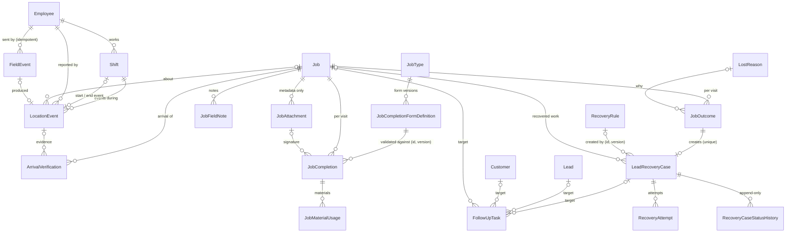
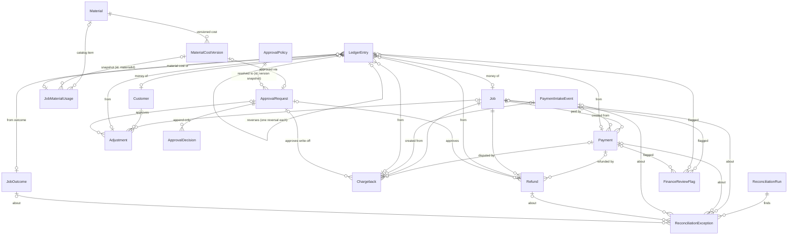
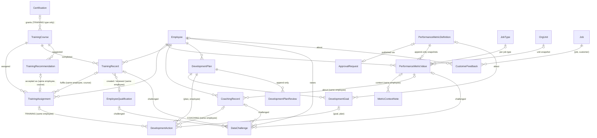
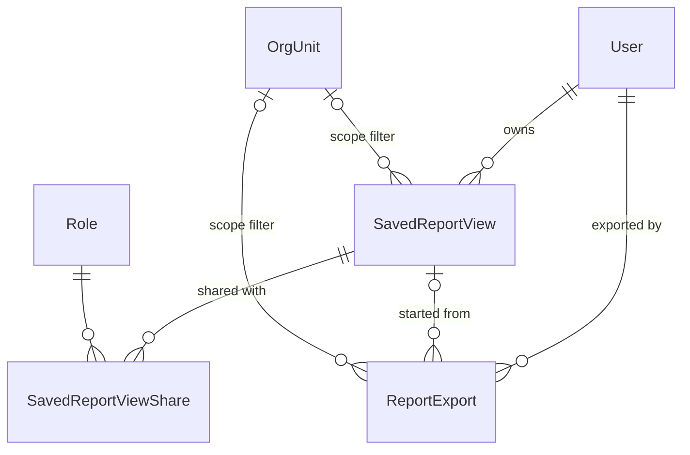

# Entity-Relationship Diagram (Phase 1 foundation, Phase 2 operational core, Phase 3 field operations, Phase 4 financial core)

Source of truth: `prisma/schema.prisma`. Every box except `Tenant` and `Permission` carries a
`tenantId` (FK to `Tenant`, FORCE-RLS protected, not drawn on each edge for readability). All
parent references between tenant-owned tables are composite `(fkId, tenantId)` foreign keys.

```mermaid
erDiagram
  Tenant ||--o{ LegalEntity : owns
  Tenant ||--o{ OrgUnit : owns
  Tenant ||--o{ User : owns
  Tenant ||--o{ Employee : owns
  Tenant ||--o{ Role : owns
  Tenant ||--o{ AuditEvent : owns

  LegalEntity ||--o{ OrgUnit : "optional legal context"
  LegalEntity ||--o{ Employee : "legal employer"
  OrgUnit ||--o{ OrgUnit : "parent / children"

  OrgUnit ||--o{ OrgUnitManager : "managed by"
  Employee ||--o{ OrgUnitManager : manages
  Employee ||--o{ OrganizationalAssignment : "placed (history)"
  OrgUnit ||--o{ OrganizationalAssignment : hosts
  User |o--o{ OrganizationalAssignment : createdBy

  User |o--o| Employee : "optional 1:1"
  User ||--o{ Session : has
  User ||--o{ AuthenticationEvent : "login history"
  User ||--o{ PasswordResetToken : has
  User |o--o{ Invitation : invitedBy

  Role ||--o{ RolePermission : grants
  Permission ||--o{ RolePermission : "catalog entry"
  User ||--o{ RoleAssignment : holds
  Role ||--o{ RoleAssignment : "assigned as"
  RoleAssignment ||--o{ AccessScope : "data scope"
  LegalEntity |o--o{ AccessScope : "scope target"
  OrgUnit |o--o{ AccessScope : "scope target"

  Tenant ||--o{ IdempotencyRecord : owns
  Tenant ||--o{ TranslationResource : owns

  Tenant {
    string id PK
    string slug UK "company code"
    string name
    enum status
    string defaultLocale
    string defaultTimeZone
  }
  LegalEntity {
    string id PK
    string tenantId FK
    string name "unique per tenant"
    boolean active
  }
  OrgUnit {
    string id PK
    string tenantId FK
    enum type "BUSINESS_UNIT STATE REGION CITY BRANCH DEPARTMENT TEAM"
    string name
    string parentId FK "self, CHECK not own parent, no cycles"
    string legalEntityId FK "optional"
    boolean active
    json address "branch"
    string timeZone "branch, nullable"
    string defaultLocale "branch, nullable"
    json operatingHours "branch"
  }
  Employee {
    string id PK
    string tenantId FK
    string userId FK "optional, unique"
    string legalEntityId FK "legal employer"
    string firstName
    string lastName
    enum status
  }
  OrgUnitManager {
    string id PK
    string orgUnitId FK
    string employeeId FK
    boolean isPrimary
    datetime effectiveFrom
    datetime effectiveTo
  }
  OrganizationalAssignment {
    string id PK
    string employeeId FK
    string orgUnitId FK
    enum kind "PRIMARY SECONDARY TEMPORARY"
    datetime effectiveFrom
    datetime effectiveTo "no overlapping PRIMARY per employee"
    string reason
    string createdById FK
  }
  User {
    string id PK
    string tenantId FK
    string email "lower-case, unique per tenant"
    string passwordHash "redacted in audit"
    enum status
    string locale "nullable"
    string timeZone "nullable"
    boolean mfaEnabled
    string mfaSecretEncrypted "AES-256-GCM, redacted in audit"
    int mfaLastUsedStep "TOTP replay guard: highest accepted time step"
  }
  Role {
    string id PK
    string name "unique per tenant"
    string templateKey "informational only"
    boolean requiresMfa
  }
  Permission {
    string id PK
    string key UK "module.action"
    string module
    enum action
    boolean sensitive
  }
  RolePermission {
    string roleId PK
    string permissionId PK
    json conditions "qualifiers for Limited grants"
  }
  RoleAssignment {
    string id PK
    string userId FK
    string roleId FK
    datetime effectiveFrom
    datetime effectiveTo "temporary access"
    string grantedById FK
    datetime revokedAt
  }
  AccessScope {
    string id PK
    string roleAssignmentId FK
    enum type "TENANT LEGAL_ENTITY ORG_UNIT OWN ASSIGNED"
    string legalEntityId FK
    string orgUnitId FK
    boolean includeDescendants
  }
  Session {
    string id PK
    string userId FK
    string tokenHash UK
    datetime expiresAt
    datetime revokedAt
    boolean mfaPending "password ok, MFA code outstanding"
    datetime mfaVerifiedAt "set when MFA was passed; null on a MFA-requiring user re-triggers the MFA step"
  }
  AuthenticationEvent {
    string id PK
    string userId FK "nullable"
    enum type
    string ipAddress
  }
  Invitation {
    string id PK
    string email
    string tokenHash UK
    string invitedById FK "nullable"
    string roleId "nullable, validated in the service"
    string employeeId "nullable"
    enum scopeType "nullable: data scope granted with roleId"
    string scopeLegalEntityId "nullable, no FK"
    string scopeOrgUnitId "nullable, no FK"
    boolean scopeIncludeDescendants
    datetime expiresAt
    datetime acceptedAt
    datetime revokedAt
  }
  PasswordResetToken {
    string id PK
    string userId FK
    string tokenHash UK
    datetime expiresAt
    datetime usedAt
  }
  AuditEvent {
    string id PK
    string actorUserId "no FK by design"
    string action
    string targetType
    string targetId
    json previousValue
    json newValue
    string reason
    enum outcome
    enum sourceApp
    string correlationId
  }
  IdempotencyRecord {
    string id PK
    string key "unique per tenant"
    string requestHash
    int responseStatus
    json responseBody
    datetime expiresAt
  }
  TranslationResource {
    string id PK
    string locale
    string key "unique per tenant+locale"
    string value
    boolean reviewed "only reviewed overrides are served (16.6)"
    datetime reviewedAt
    string reviewedById FK "nullable"
    string updatedById FK "nullable"
  }
```

## Database-level rules not visible in the diagram

- RLS (FORCE) policy `tenant_isolation` on all 47 tenant-owned tables (17 Phase 1 + 30 Phase 2; each RLS migration applies it to
  every table that has a `tenantId` column; a test asserts none is missed).
- `AuditEvent`: trigger rejects UPDATE / DELETE / TRUNCATE.
- `OrgUnit`: CHECK `parentId <> id`; trigger rejects longer cycles.
- `OrganizationalAssignment`: exclusion constraint - at most one PRIMARY placement per employee at
  any instant; `effectiveTo > effectiveFrom`.
- `AccessScope`: CHECK that LEGAL_ENTITY/ORG_UNIT scopes carry their target and the others do not.
- `User.email` / `Invitation.email` lower-case CHECK; locale columns CHECK in (`en-US`,`es-US`,`he-IL`).

---

# Phase 2: operational core

Migration `20261122121345_phase2_operational_core` (one migration: tables, enums, indexes, composite FKs, RLS,
CHECKs, partial unique indexes, append-only triggers). Same conventions as above: every table carries `tenantId`
(FORCE RLS), every reference between tenant-owned tables is a composite `(id, tenantId)` FK, every table has
`@@unique([id, tenantId])`. Enum values are language-neutral identifiers; the statuses are the spec's (6.3, 7.2).

## Diagram

```mermaid
erDiagram
  Customer ||--o{ CustomerAddress : "service addresses"
  Customer ||--o{ CustomerNote : notes
  OrgUnit |o--o{ Customer : "service area"
  OrgUnit |o--o{ CustomerAddress : "service area"

  LeadSource |o--o{ Lead : source
  Customer |o--o{ Lead : "linked customer"
  CustomerAddress |o--o{ Lead : "address (must be the customer's)"
  JobType |o--o{ Lead : "requested type"
  OrgUnit |o--o{ Lead : routing
  Lead |o--o{ Lead : "duplicateOf"
  Lead ||--o{ LeadAssignment : "owner history (1 ACTIVE)"
  Employee ||--o{ LeadAssignment : owns
  Lead ||--o{ LeadStatusHistory : "append-only"
  Lead ||--o{ LeadInteraction : "attempts, notes"
  Lead |o--o{ DuplicateFlag : "lead / otherLead"
  Customer |o--o{ DuplicateFlag : "customer / otherCustomer"

  JobType ||--o{ JobTypeSkill : requires
  JobType ||--o{ JobTypeCertification : requires
  Skill ||--o{ JobTypeSkill : ""
  Certification ||--o{ JobTypeCertification : ""
  JobType ||--o{ Job : "type of"
  Customer ||--o{ Job : "for"
  CustomerAddress ||--o{ Job : "service address (must be the customer's)"
  OrgUnit ||--o{ Job : "service area"
  Lead |o--o| Job : "converted into (at most one)"
  Job |o--o{ Job : "return visit / follow-up"
  Job ||--o{ JobRequirement : "needs (copied from type + manual)"
  Job ||--o{ JobAssignment : "crew history"
  Employee |o--o{ JobAssignment : does
  OrgUnit |o--o{ JobAssignment : "team assignment"
  Job ||--o{ JobStatusHistory : "append-only"
  Job ||--o{ JobEvent : "append-only log"
  Job ||--o{ DispatchRecommendation : "ranked candidates"
  DispatchRecommendation |o--o{ JobAssignment : "came from"

  Employee ||--o{ EmployeeQualification : holds
  Skill |o--o{ EmployeeQualification : ""
  Certification |o--o{ EmployeeQualification : ""
  Employee ||--o{ ServiceTerritory : "may serve"
  OrgUnit ||--o{ ServiceTerritory : ""
  Employee ||--o{ Availability : "weekly windows + exceptions"

  User ||--o{ Notification : receives
  Notification ||--o{ NotificationDelivery : "one row per channel attempt"
  User ||--o{ NotificationPreference : "opt-in / out"

  Tenant ||--o| OperationsSettings : "one row"
  Tenant ||--o{ NumberSequence : "customer / lead / job numbers"

  Customer {
    string id PK
    int number "unique per tenant (NumberSequence)"
    enum kind "INDIVIDUAL BUSINESS"
    string name "trigram index"
    string email "lower-case CHECK"
    string phoneE164 "normalized match key"
    string preferredLocale "en-US es-US he-IL"
    string orgUnitId FK "service area, nullable"
    string billingFields "billing set: opt-in field category"
    datetime archivedAt "soft remove"
  }
  CustomerAddress {
    string id PK
    string customerId FK
    decimal latitude "optional, -90..90"
    decimal longitude "optional, -180..180, pair with latitude"
    string normalizedKey "duplicate-address match key"
    string orgUnitId FK "service area"
  }
  Lead {
    string id PK
    int number
    enum status "12 spec 6.3 statuses"
    enum priority
    string sourceId FK
    string externalId "unique per source (webhook idempotency)"
    string customerId FK "nullable until linked"
    string contactPhoneE164 "normalized"
    int quotedAmountMinor "cents, >= 0"
    string currency "ISO 4217"
    datetime nextFollowUpAt
  }
  LeadAssignment {
    string id PK
    enum state "ACTIVE ENDED: one ACTIVE per lead"
    boolean conflictConfirmed "spec 25.1"
  }
  LeadInteraction {
    string id PK
    enum kind "CONTACT_ATTEMPT NOTE CUSTOMER_MESSAGE FOLLOW_UP"
    enum channel
    enum outcome
    datetime closedAt "null = open attempt"
  }
  DuplicateFlag {
    string id PK
    enum kind "LEAD_LEAD CUSTOMER_CUSTOMER LEAD_CUSTOMER"
    string pairKey "unique per tenant, sorted ids"
    enum status "OPEN NOT_DUPLICATE CONFIRMED_DUPLICATE"
  }
  JobType {
    string id PK
    string code "unique per tenant"
    string category
    int defaultDurationMinutes "1..10080"
    boolean requiresReview
    json completionFormSchema "Phase 3 placeholder"
  }
  Job {
    string id PK
    int number
    enum status "16 spec 7.2 statuses"
    string customerId FK
    string serviceAddressId FK "belongs to the same customer"
    string orgUnitId FK "service area, drives ORG_UNIT scope"
    datetime appointmentWindowStart "both or neither, end > start"
    datetime scheduledStartAt "both or neither, end > start"
    int estimatedDurationMinutes "1..10080"
    int quotedAmountMinor "financial field set"
  }
  JobAssignment {
    string id PK
    string employeeId FK "xor teamOrgUnitId"
    enum role "LEAD CREW"
    enum state "ACTIVE ENDED"
    enum method "MANUAL RECOMMENDATION_* OVERRIDE"
    string overrideReason "required for OVERRIDE"
  }
  JobEvent {
    string id PK
    string type "dotted key: job.assigned"
    string clientEventId "unique per job: double-submit guard"
    json payload
  }
  DispatchRecommendation {
    string id PK
    enum mode "MANUAL AI_ASSISTED (others refused)"
    enum status "PENDING APPROVED MODIFIED REJECTED SUPERSEDED"
    json candidates "ranked, every factor explained"
    json blockingReasons "why nobody is eligible"
  }
  EmployeeQualification {
    string id PK
    enum kind "SKILL CERTIFICATION LICENSE EQUIPMENT"
    string skillId FK "xor certificationId"
    int level "1..5, skills only"
    date expiresAt "null = no expiry"
    enum status "PENDING_VERIFICATION VERIFIED REJECTED REVOKED"
    string verifiedById FK "required when VERIFIED"
  }
  Availability {
    string id PK
    enum kind "WEEKLY_WINDOW EXCEPTION_AVAILABLE EXCEPTION_UNAVAILABLE"
    string timeZone "IANA"
    int isoDayOfWeek "1=Mon..7=Sun"
    int startMinute "after LOCAL midnight"
  }
  Notification {
    string id PK
    string recipientId FK "User"
    string eventType "dotted key: lead.assigned"
    string idempotencyKey "unique per recipient"
    string templateKey "rendered at read time in the recipient's language"
    boolean critical "ignores opt-outs"
    datetime readAt
  }
  NotificationDelivery {
    string id PK
    enum channel "IN_APP PUSH EMAIL SMS"
    int attempt "unique per notification+channel"
    enum status "PENDING SENT DELIVERED FAILED NOT_CONFIGURED SKIPPED"
    json providerResponse
    string failureReason "required when FAILED"
    enum retryStatus "NONE SCHEDULED EXHAUSTED"
    datetime nextRetryAt
  }
  OperationsSettings {
    string id PK
    enum dispatchMode "AI_ASSISTED default"
    string disabledJobTransitions "narrowing only"
    json duplicateMatchers
    enum enabledChannels "IN_APP default"
  }
```

## Model guide (what each table is for, who uses it)

| Model | Purpose | Main consumers |
|---|---|---|
| `NumberSequence` | per-tenant counters for human numbers; names `customer`, `lead`, `job` | customers, leads, jobs |
| `OperationsSettings` | one row per tenant: dispatch mode, disabled (narrowed) lifecycle transitions, duplicate matchers, channels, contact-attempt window, expiry warning days, development thresholds of the training-recommendation metric rule (`developmentThresholds` JSON array, null = rule disabled; Phase 5 Task 5); absent row = defaults | leads, jobs, dispatch, notifications, customers |
| `Customer` / `CustomerAddress` / `CustomerNote` | spec 6.1. Phone stored as typed + E.164; email lower-case; billing columns are the opt-in `billing` field set; archive via `archivedAt` | customers |
| `LeadSource` | tenant-configured sources (`code` unique), typed per spec 6.2 | leads |
| `Lead` | intake record; contact fields as received (a lead may precede its customer); address as received or linked; `externalId`+`sourceId` unique (webhook idempotency, spec 25.1) | leads |
| `LeadAssignment` | owner history; exactly one `ACTIVE` row per lead is the owner | leads (ASSIGNED scope) |
| `LeadStatusHistory`, `JobStatusHistory` | append-only status trail (from, to, actor type/user, reason, time) | leads, jobs |
| `LeadInteraction` | contact attempts (open while `closedAt` is null), notes, customer messages, follow-ups | leads |
| `DuplicateFlag` | flagged pair + matched fields + resolution; never auto-merged | customers, leads |
| `Skill`, `Certification` | catalogs; `Certification.type` is CERTIFICATION, LICENSE or EQUIPMENT | qualifications |
| `EmployeeQualification` | an employee's skill (level 1-5) or credential (number, issued/expires dates, verification); renewal = new row | qualifications, dispatch |
| `ServiceTerritory` | org units an employee may be dispatched into (with descendants) | qualifications, dispatch |
| `Availability` | weekly windows + dated exceptions in an IANA time zone | qualifications, dispatch, technician |
| `JobType` + `JobTypeSkill` + `JobTypeCertification` | catalog of job types with default duration/priority and required skills / credentials / equipment qualifications | jobs, leads, dispatch |
| `Job` | spec 7.1 record; appointment window (customer-facing) vs scheduled slot (dispatcher's); money in minor units | jobs, dispatch, technician |
| `JobRequirement` | THIS job's requirements (copied from the type at creation + manual additions); the only table eligibility reads | qualifications, dispatch |
| `JobAssignment` | crew history: employee or team, `LEAD`/`CREW`, how it was decided (manual / recommendation / override + reason) | jobs, dispatch, technician (ASSIGNED scope) |
| `JobEvent` | append-only event log; `type` is a dotted key; `clientEventId` makes technician re-submits idempotent | jobs, dispatch, technician (Phase 3 arrival/start/complete) |
| `DispatchRecommendation` | one generated recommendation: ranked candidates with factors, or blocking reasons; decision (approve / modify / reject) | dispatch |
| `Notification` / `NotificationDelivery` / `NotificationPreference` | spec 14.3: inbox row per recipient + one delivery row per channel attempt; opt-outs for non-critical only | notifications |

## Who is "assigned" (ASSIGNED scope)

There is NO denormalized `assignedTo` column on `Lead` or `Job`. The current assignee is the `ACTIVE` row of
`LeadAssignment` / `JobAssignment` (partial unique indexes guarantee one ACTIVE lead owner per lead, one ACTIVE
`LEAD` per job, and no employee/team twice among a job's ACTIVE rows). Queries use the
`(tenantId, employeeId, state)` indexes; a technician's jobs are
`jobAssignment where employeeId = me and state = ACTIVE` joined to `Job` (index `Job (tenantId, status, scheduledStartAt)`
and `Job (tenantId, orgUnitId, status, scheduledStartAt)` serve the board and the day schedule).

## Indexes for the list and search queries

| Query | Index |
|---|---|
| customers by phone / email / number | `Customer (tenantId, phoneE164)`, `(tenantId, email)`, unique `(tenantId, number)` |
| customer name search (`ILIKE '%x%'`, similarity) | GIN trigram `Customer_name_trgm_idx` (extension `pg_trgm`) |
| customer address duplicates | `CustomerAddress (tenantId, normalizedKey)`, `(tenantId, postalCode)` |
| leads by status / age / follow-up / area / priority | `Lead (tenantId, status, createdAt)`, `(tenantId, status, nextFollowUpAt)`, `(tenantId, orgUnitId, status)`, `(tenantId, priority, status)` |
| lead duplicate matching | `Lead (tenantId, contactPhoneE164)`, `(tenantId, contactEmail)`, `(tenantId, addressNormalizedKey)`, unique `(tenantId, sourceId, externalId)`; name: GIN trigram `Lead_contactName_trgm_idx` |
| "my leads" / owner queues | `LeadAssignment (tenantId, employeeId, state)`, `(tenantId, leadId, state)` |
| dispatch board / day schedule | `Job (tenantId, status, scheduledStartAt)`, `(tenantId, orgUnitId, status, scheduledStartAt)`, `(tenantId, appointmentWindowStart)` |
| customer history | `Job (tenantId, customerId, createdAt)`, `Lead (tenantId, customerId)` |
| "my jobs" | `JobAssignment (tenantId, employeeId, state)`, `(tenantId, teamOrgUnitId, state)` |
| certifications expiring | `EmployeeQualification (tenantId, expiresAt)` |
| availability lookup | `Availability (tenantId, employeeId, kind, isoDayOfWeek)`, `(tenantId, employeeId, startsAt, endsAt)` |
| notification inbox / unread | `Notification (tenantId, recipientId, readAt, createdAt)` |
| delivery retry worker | partial `NotificationDelivery_due_retry_idx` where `retryStatus = SCHEDULED` |

## Database-level rules (Phase 2)

All names are part of the contract (asserted in `tests/db/phase2-schema.test.ts`).

- **RLS**: the migration re-runs the Phase 1 DO-block over every table with a `tenantId` column.
- **Composite FKs**: `Job (serviceAddressId, customerId, tenantId)` and `Lead (customerAddressId, customerId, tenantId)`
  reference `CustomerAddress (id, customerId, tenantId)`: an address can never belong to another customer or tenant.
  `lead_address_needs_customer` closes the MATCH SIMPLE gap for a lead with an address but no customer.
- **Append-only** (trigger, UPDATE/DELETE/TRUNCATE rejected): `LeadStatusHistory`, `JobStatusHistory`, `JobEvent`.
- **Partial unique indexes**: `LeadAssignment_one_active_per_lead`, `JobAssignment_one_active_lead_per_job`,
  `JobAssignment_one_active_per_job_employee`, `JobAssignment_one_active_per_job_team`.
  (Prisma does not model partial indexes; `prisma migrate dev` leaves them alone, verified.)
- **Money**: `lead_amount_non_negative`, `job_amount_non_negative`, `*_currency_format` (`^[A-Z]{3}$`).
- **Geo**: `customer_address_latitude_range`, `customer_address_longitude_range`, `customer_address_coordinates_pair`.
- **Time windows**: `job_appointment_window`, `job_scheduled_slot` (both or neither, end after start),
  `lead_preferred_window_order`, `job_duration_range` / `job_type_duration_range` (1..10080 minutes),
  `service_territory_dates`, `availability_shape` (weekly vs exception columns, minute ranges), `availability_valid_dates`.
- **Formats**: lower-case emails, E.164 phones (`+15551234567`), supported locales, `*_code_format`
  (`^[a-z0-9][a-z0-9_-]{0,62}$`), dotted event types (`job_event_type_format`, `notification_event_type_format`).
- **State consistency**: `*_assignment_state_ended` (ENDED iff `endedAt`), `job_assignment_target` (employee xor team),
  `job_assignment_override_reason`, `job_assignment_recommendation_link`, `dispatch_recommendation_decision`,
  `duplicate_flag_shape` / `duplicate_flag_resolution`, `employee_qualification_target` (skill xor credential),
  `employee_qualification_level` (1-5, skills only), `employee_qualification_dates`,
  `employee_qualification_verified` (VERIFIED needs verifier + time), `certification_not_skill`,
  `notification_delivery_failure_reason`, `notification_delivery_retry_time`, `*_status_history_changed`.

## Phase 2 fix round 1 (migration `20261122140000_phase2_schema_fixes`)

New tables (RLS, composite FKs like all others; now 47 tenant-owned tables):

| Model | Purpose |
|---|---|
| `EmployeeJobPermission` | spec 10.1 job-category permissions: an employee may take jobs of ONE `jobTypeId` XOR one `category` (CHECK `employee_job_permission_target`), time-bounded (`effectiveFrom/To`), `grantedById`. The qualification engine treats it as a hard requirement: a matching active row must exist. |
| `CustomerPreferredEmployee` | spec 7.3 soft factor "customer preference": `PREFERRED` / `AVOID` per (customer, employee), unique. Soft ranking only, never eligibility. |

Column and constraint changes:
- `QualificationKind` gains `TRAINING` (a `Certification` catalog row of type TRAINING; "Training" in spec 10.1).
- `OrgUnit.latitude/longitude` (branch/depot) and `Employee.startLatitude/startLongitude` (optional home/depot start): `Decimal(9,6)`, range CHECKs (`org_unit_*`, `employee_start_*`) and both-or-neither. Origins for straight-line (haversine) distance; with `CustomerAddress` coordinates a distance is computable. Missing coordinates mean "distance unknown", never a guess.
- `EmployeeQualification (certificationId, kind, tenantId)` is now a composite FK to `Certification (id, type, tenantId)`: the DB enforces kind = the credential's type.
- `JobAssignment (recommendationId, jobId, tenantId)` references `DispatchRecommendation (id, jobId, tenantId)`: a recommendation can only be linked to assignments of its own job.
- `Job (leadId, customerId, tenantId)` references `Lead (id, customerId, tenantId)`: a job's lead belongs to the job's customer. Consequence for conversion: the lead must be linked to its customer (`Lead.customerId`) BEFORE the job is created. `Lead.job` became `jobs` in the client (still at most one job per lead: unique `(leadId, tenantId)`).
- `OperationsSettings (updatedById, tenantId)` is a composite FK to `User`.

## Contracts for JSON and polymorphic references

`DispatchRecommendation.candidates` / `blockingReasons`, `Notification.params` / `eventId` / `targetId`, `JobEvent.payload`, `Customer.contactPreferences`, `OperationsSettings.duplicateMatchers` are not foreign-key protected. Rules for every writer and reader:
1. **Ids only.** Store identifiers and codes (employee ids, factor keys, numbers, enums), never names, phone numbers, addresses or other PII, and no text copied from other records.
2. **Resolve through tenant-scoped queries and re-check authorization** (`withTenant` + the module's `enforceInTx` / `withinScope`) when displaying: an id found in JSON may point at something the viewer may not see (then show nothing or a neutral placeholder), or at nothing (deleted, other tenant: treat as missing). Never join on it blindly or trust it as proof of access.
3. Money and customer preferences that matter to logic are columns or rows (e.g. `CustomerPreferredEmployee`), not JSON.

## Documented rules not expressible in the database

- **Lead intake must always set `sourceId`.** The unique index `(tenantId, sourceId, externalId)` ignores rows with a NULL source (NULLs are distinct in Postgres), so webhook de-duplication only works with a source. Services default to the tenant's `manual`/`api` source rather than leaving it NULL.
- **Availability windows cannot cross midnight.** `WEEKLY_WINDOW` needs `endMinute > startMinute` within one local day (CHECK `availability_shape`); a night shift is two windows (e.g. 22:00-24:00 on Monday, 00:00-06:00 on Tuesday). The qualification engine (Task 3) must evaluate the window in its own `timeZone` per local date, including DST days (a 02:30 start that does not exist or occurs twice).

---

# Phase 3: field operations and recovery

Migration `20261123100000_phase3_field_operations` (schema only; services arrive in Phase 3 Tasks 2-7). 17 new tenant-owned tables
(64 in total), all with `tenantId`, `(id, tenantId)` unique keys, composite `(ref, tenantId)` FKs and FORCE RLS (the Phase 1/2 DO-block
runs again over the whole schema). Constraint and index names are asserted in `tests/db/phase3-schema.test.ts`.

## Model guide

| Model | Purpose | Main consumers (planned) |
|---|---|---|
| `Shift` | spec 8.1: one working shift. Partial unique `Shift_one_active_per_employee` makes "start shift" idempotent. Start/end exception (`LocationException` + note). `orgUnitId` is the employee's placement at start (snapshot) so manager scope does not depend on later moves. Exception review for `shifts.approve`: `exceptionReviewStatus` (PENDING / APPROVED / REJECTED, null = no exception), `reviewedById`, `reviewedAt`, `reviewNote` (`shift_exception_review`). | shifts |
| `LocationEvent` | spec 17: one position or one failed capture. **Sensitive.** Dual timestamps (`deviceTime`, `serverTime`), `source` (DEVICE_GPS, GEOFENCE, MANUAL, MANAGER), `accuracyM`, `verification` (UNVERIFIED, WITHIN_RADIUS, OUTSIDE_RADIUS, MANAGER_VERIFIED), `coordinatesPurgedAt` (retention), straight-line `distanceToJobM` vs `geofenceRadiusM`. Kinds: SHIFT_START, SHIFT_END, ARRIVAL, DEPARTURE, NAVIGATION_OPENED (never changes status, never arrival), VERIFICATION. | shifts, arrival, recovery (presence) |
| `ArrivalVerification` | spec 8.4 / 17.2: how an arrival was established (TECHNICIAN, GEOFENCE, MANAGER), `status` (RECORDED, PENDING_MANAGER_REVIEW, MANAGER_VERIFIED, MANAGER_REJECTED), exception reason, manager decision with mandatory note. Several rows per job; wording is always about confidence. | arrival |
| `FieldEvent` | spec 8.7 / 25.3: ingestion log of device events. **Unique `(tenantId, employeeId, clientEventId)`**: a replay finds the row and returns the stored result (`ACCEPTED` / `REJECTED` / `CONFLICT` + `resultCode`). Rejected events are stored too. `occurredAt` (device) vs `receivedAt` (server); applied in `occurredAt` order; `batchId` groups a sync batch. | field execution + sync |
| `JobCompletionFormDefinition` | spec 8.6: versioned form for ONE job type XOR ONE category. One ACTIVE per type/category (partial unique), only DRAFT may change `schema` (trigger). | completion forms |
| `JobCompletion` | one submitted form per `(job, visitNumber)`: answers snapshot + the exact `(definition, version)` (composite FK). | field execution |
| `JobMaterialUsage` | material used: free text + `materialRef` placeholder for the Phase 4 catalog, quantity `Decimal(12,3)`, unit. | field execution |
| `JobFieldNote` | spec 8.5 notes, work performed, additional work requested, customer approval (optional amount in minor units). Free text lives here, not in events. | field execution |
| `JobAttachment` | photo / signature / document **metadata**. No storage provider: rows are PENDING_UPLOAD; STORED needs `storageKey` + `storageProvider` (CHECK). | field execution |
| `LostReason` | spec 9.2: tenant-configurable (`code`, `name`, `appliesTo` outcomes, `recoverable`, `active`, `sortOrder`). Deactivate, never delete. | outcomes, recovery |
| `JobOutcome` | spec 9.1: one per `(job, visitNumber)`; outcome, lost reason (required for NOT_SOLD / WORK_NOT_POSSIBLE, forbidden for SOLD: CHECK), quoted / approved / charged / collected (minor units), payment method + status, `customerRequestedFollowUp`. | outcomes, recovery |
| `RecoveryRule` | spec 9.6: versioned (`ruleKey` + `version`, one ACTIVE version per key), `status` (DRAFT, PENDING_APPROVAL, ACTIVE, INACTIVE, SUPERSEDED), `priority`, `trigger`, `conditions`, `actions`, org-unit scope, `cooldownMinutes` (loop safety). High-impact + ACTIVE needs an approver other than the author (CHECK). | recovery |
| `LeadRecoveryCase` | spec 9.3-9.5, 9.7: one per outcome (unique `jobOutcomeId` = idempotent creation), status machine fields, priority + score, assignee, presence **snapshot**, `estimatedValueMinor` (estimate) vs `recoveredAmountMinor` / `collectedAmountMinor` (confirmed, need `recoveredAt`), `recoveredJobId` and `recoveredLeadId` (same customer, composite FKs), `(ruleId, ruleVersion)` is a real rule version. UNKNOWN presence requires `presenceReason` and no evidence event; AT/LEFT require the technician's own event. | recovery |
| `RecoveryCaseStatusHistory` | append-only status trail (trigger). | recovery |
| `RecoveryRuleRun` | append-only record of one rule version evaluated for one job outcome: `matched`, `actionsTaken` (action codes), `skippedReason` (e.g. `cooldown`). Unique `(tenantId, ruleId, jobOutcomeId)` makes the engine idempotent and loop-safe; cooldown = latest run of the rule for the same customer inside `cooldownMinutes`. Dry runs are not stored. | recovery |
| `RecoveryAttempt` | one communication attempt (channel, outcome, duration, notes, amount offered by the employee, never by the system). | recovery |
| `FollowUpTask` | generic task; `targetType` selects exactly ONE of `leadId` / `customerId` / `jobId` / `recoveryCaseId` (CHECK + composite FKs). `dedupeKey` unique per tenant; `dueSoonNotifiedAt` / `overdueNotifiedAt` make the sweep send each notification once. | follow-ups |

Columns added to Phase 2 tables: `Job.currentVisitNumber` (default 1: the `visitNumber` outcomes and completions of this job use; the jobs lifecycle increments it in the same transaction when a job whose current visit already has a `JobOutcome` moves to a visit-start status (`VISIT_START_STATUSES`, the technician is on the way again) from a status that is not itself one, and not when a reviewer sends AWAITING_REVIEW work back to IN_PROGRESS. **Supersedes the earlier "returns to SCHEDULED after ..." wording.**), `Job.enRouteAt`, `Job.arrivedAt` (milestones; `startedAt` is work start); `Job` unique `(id, customerId, tenantId)`
(lets a recovery case tie job and customer together); `CustomerAddress.geofenceRadiusM` (per-site override); `OperationsSettings`:
`arrivalGeofenceRadiusM` (150), `locationMaxAccuracyM` (100), `presenceMaxAgeMinutes` (30), `locationRetentionDays` (90),
`followUpDueSoonMinutes` (60). `JobType.completionFormSchema` (Phase 2 placeholder) is superseded by `JobCompletionFormDefinition` and must not be read.

## Location data is sensitive (spec 17, 22.2)

- **Event-based only**: rows exist for shift start/end, arrival, departure, navigation-opened and approved verification. No polling table.
- **Own permission and field set**: `location.view` (sensitive) reads events and verifications WITHOUT coordinates; raw `latitude` / `longitude`
  are the opt-in `coordinates` field set (`location.coordinate_fields`, `LOCATION_EVENT_FIELD_MAP`), held by the Owner template only.
  Coordinates exist in exactly one table (`LocationEvent`); `ArrivalVerification` and `LeadRecoveryCase` keep distance, accuracy, ids and status.
- **Accuracy is mandatory with a position** (`location_event_accuracy_with_coordinates`) and both clocks are kept; GPS is never stored as "proof".
- **Retention (one strategy: purge the coordinates, keep the row)**: `OperationsSettings.locationRetentionDays` (default 90, range 1-3650). The retention
  function (a callable function only; no scheduler exists yet) runs `UPDATE "LocationEvent" SET latitude = NULL, longitude = NULL, "coordinatesPurgedAt" = now()`
  for rows whose `serverTime` is older than the setting (index `LocationEvent_tenantId_serverTime_idx`). Rows are NOT deleted: shifts (start/end event),
  arrivals (GEOFENCE evidence) and recovery cases (presence evidence) reference them with RESTRICT foreign keys, and kind, times, accuracy, distance and
  verdict are the non-sensitive record those modules need. The CHECKs allow exactly this: `location_event_position_or_reason` and
  `location_event_radius_verdict_needs_data` accept `coordinatesPurgedAt IS NOT NULL`, and `location_event_purged_has_no_coordinates` forbids coordinates on a
  stamped row. Tested on an event referenced by a shift, an arrival and a case.
- **Coordinates never appear in any JSON column** (`FieldEvent.payload`, `RecoveryRuleRun.actionsTaken`, rule `conditions`/`actions`, form `values`, audit
  values): they live only in `LocationEvent.latitude/longitude`, where the purge can reach them. Not expressible as a CHECK; every writer must pass payloads through
  a service-level validator that rejects keys such as `latitude`, `longitude`, `lat`, `lng`, `coords` (built with the shifts/field-sync tasks).
- Presence for recovery uses the latest event newer than `presenceMaxAgeMinutes` with `accuracyM <= locationMaxAccuracyM`; otherwise UNKNOWN (spec 26.5).

## Database-level rules (Phase 3)

- **RLS**: the same fail-closed DO-block as before; `tests/db/rls.test.ts` lists the 17 tables.
- **Composite FKs with extra guards**: `LocationEvent (shiftId, employeeId, tenantId) -> Shift` (an event's shift is the same employee's);
  `Shift (start/endLocationEventId, employeeId, tenantId) -> LocationEvent (id, employeeId, tenantId)`; `ArrivalVerification (locationEventId, jobId, employeeId, tenantId) -> LocationEvent` (evidence is the arriving employee's, for the arrival's job); `ArrivalVerification (fieldEventId, tenantId) -> FieldEvent`; `JobCompletion (signatureAttachmentId, jobId, tenantId) -> JobAttachment` and `JobMaterialUsage (completionId, jobId, tenantId) -> JobCompletion` (same job); `LeadRecoveryCase (presenceLocationEventId, technicianId, tenantId) -> LocationEvent (id, employeeId, tenantId)` and `(ruleId, ruleVersion, tenantId) -> RecoveryRule (id, version, tenantId)`;
  `JobCompletion (formDefinitionId, formVersion, tenantId) -> JobCompletionFormDefinition (id, version, tenantId)`;
  `LeadRecoveryCase (jobOutcomeId, jobId, tenantId) -> JobOutcome`, `(jobId, customerId, tenantId) -> Job`, `(leadId, customerId, tenantId) -> Lead`,
  `(recoveredJobId, customerId, tenantId) -> Job`, `(recoveredLeadId, customerId, tenantId) -> Lead`.
- **Idempotency keys**: `FieldEvent (tenantId, employeeId, clientEventId)`; `(tenantId, jobId, clientEventId)` on `JobCompletion`, `JobMaterialUsage`,
  `JobFieldNote`, `JobAttachment`, `JobOutcome`; `LocationEvent (tenantId, fieldEventId)`; `FollowUpTask (tenantId, dedupeKey)`.
- **Partial unique indexes**: `Shift_one_active_per_employee`, `JobCompletionFormDefinition_one_active_per_job_type` / `_per_category`,
  `RecoveryRule_one_active_per_key`. Sweep indexes: `FollowUpTask_open_due_idx`, `ArrivalVerification_pending_review_idx`.
- **Triggers**: `RecoveryCaseStatusHistory` and `RecoveryRuleRun` append-only; `recovery_rule_guard` (once a rule leaves DRAFT its `conditions`, `actions`, `trigger`, `priority`, `orgUnitId`, `highImpact`, `ruleKey`, `version` and `createdById` are immutable, so an approval stays bound to the approved content; status only moves PENDING_APPROVAL -> ACTIVE | INACTIVE, ACTIVE -> INACTIVE | SUPERSEDED, INACTIVE -> ACTIVE | SUPERSEDED); `job_completion_form_definition_guard` (a published definition's schema, version and target are
  immutable, status only moves DRAFT -> ACTIVE -> RETIRED).
- **CHECKs** (names in the migration): location (`location_event_*`: ranges, pair, accuracy, device time, position-or-reason, kind needs job/shift,
  manager recorder, radius verdict needs data), shifts (`shift_*`), arrivals (`arrival_verification_*`), field events (`field_event_*`: UUID, dotted type,
  result code), forms (`job_completion_form_*`), notes / attachments (`job_field_note_*`, `job_attachment_*`), outcomes (`job_outcome_*`: reason rules,
  non-negative money, payment needs collected + method), rules (`recovery_rule_*`: formats, JSON shape; `highImpact` requires `createdById`, and ACTIVE + high impact requires an approver other than the author. The service DERIVES `highImpact` from the actions (case creation, notification, task creation) rather than trusting the author's flag), cases
  (`lead_recovery_case_*`: confirmed revenue needs `recoveredAt`, closed iff NOT_RECOVERED/CLOSED, ASSIGNED has an owner, presence evidence, not its own
  recovery), follow-ups (`follow_up_task_*`: target shape, state consistency, cancel reason), settings ranges
  (`operations_settings_location_ranges`, `customer_address_geofence_radius`).

## Contracts for JSON and polymorphic references (Phase 3)

The Phase 2 rules apply (ids only, resolve through tenant-scoped queries and re-check authorization). Per column:
- `FieldEvent.payload`: ids and enum values of the thing the event refers to; free text lives in `JobFieldNote` / `JobOutcome` / ... which the payload points at.
  `entityType` + `entityId` name what the event created or changed (resolve through a tenant-scoped query).
- `JobCompletionFormDefinition.schema`: `{ "fields": [ { "key", "type", "required", "labelKey" } ] }`; `key` is from the closed vocabulary
  `outcome, quotedAmount, approvedAmount, finalChargedAmount, amountCollected, paymentMethod, paymentStatus, materials, photos, notes,
  customerSignature, followUpRequired`; `type` is `select | money | text | longtext | boolean | materials | photos | signature`; labels are i18n keys.
  The database checks only the outer shape (object with a `fields` array); the completion service validates the rest.
- `JobCompletion.values`: the ONE documented exception to "ids only": the technician's answers keyed by field key (validated against the form version).
  Amounts and the payment record live in `JobOutcome` columns, materials in `JobMaterialUsage`, photos in `JobAttachment`; `values` repeats none of them.
- `RecoveryRule.conditions`: an object of ids / enum values / numbers, e.g. `{ "outcomes": ["NOT_SOLD"], "lostReasonIds": ["<id>"], "presence": ["AT_LOCATION"],
  "minValueMinor": 100000, "jobTypeIds": ["<id>"] }`. `RecoveryRule.actions`: an array of `{ "type": "create_case" | "set_priority" | "notify" | "create_follow_up" | "recommend", ... }` (`set_priority` was added after this document was written; see DECISIONS "Action vocabulary")
  with codes only (`audience`, `priority`, `code`); there is no discount action and the engine must refuse one.

## Documented rules not expressible in the database

- Follow-up history is the AUDIT trail only (`follow_up.create | update | assign | unassign | status_change`, with ids and field names, never free text): there is no `FollowUpStatusHistory` table, unlike leads and recovery cases.
- A job is not allowed to close without an outcome (Task 5, service check; the schema offers `JobOutcome (job, visitNumber)`).
- The latest non-rejected `ArrivalVerification` of a job is its arrival; `NAVIGATION_OPENED` events never create one.
- `LocationEvent` rows are immutable by convention (a correction is a new event); the only update is the retention purge of coordinates (never deleted).
- A `LeadRecoveryCase` status change always writes `RecoveryCaseStatusHistory` in the same transaction (service rule).

# Phase 4: financial core

Migrations `20261124100000_phase4_financial_core` and `20261125100000_phase4_review_flags` (schema only; services arrive in
Phase 4 Tasks 2-6, none of which add a migration; the second one exists because the first was already applied to the shared
databases when Task 1 found the gap). 14 new tenant-owned tables (78 in total) with `tenantId`, `(id, tenantId)` unique keys, composite `(ref, tenantId)`
FKs and FORCE RLS (the DO-block runs again over the whole schema). Existing `Int` money columns became `BigInt`
(`Job`, `Lead`, `JobOutcome`, `JobFieldNote`, `LeadRecoveryCase`, `RecoveryAttempt`). Names are asserted in
`tests/db/phase4-schema.test.ts`. **No compensation, commission or payroll tables exist**: they wait for the owner's compensation
specification (spec 28.4, docs/DECISIONS.md).

## Model guide

| Table | Purpose |
|---|---|
| `Material` | Catalog item (code unique per tenant). Carries no cost: cost lives in versions (spec 11.4). |
| `MaterialCostVersion` | One unit cost for a period. PENDING_APPROVAL -> APPROVED / REJECTED / CANCELLED. Approved versions never overlap (exclusion constraint) and never change; a newer version closes the old one by setting `effectiveTo`. `approvalRequestId` null = no policy applied. |
| `JobMaterialUsage` (extended) | `materialId`, `costVersionId` + `unitCostMinor`, `extendedCostMinor`, `costCurrency`, `costedAt` = the snapshot taken when the usage was costed. All-or-nothing; frozen once set, so a later cost change never rewrites a past job (spec 25.4). `quantity` is a `Decimal(12,3)`, so how `extendedCostMinor` is derived from it (no float, no hidden rounding) is decided by Task 2. |
| `LedgerEntry` | Append-only money ledger. Type decides the sign (CHARGE, PAYMENT > 0; REFUND, CHARGEBACK, MATERIAL_COST < 0; ADJUSTMENT either; REVERSAL = minus the reversed entry). `source` names the producing record and its id column must be set. `idempotencyKey` unique per tenant. `orgUnitId` / `legalEntityId` are snapshots at posting time (entries never change) so finance queries scope without a join. Actor = user XOR `system:<name>`. |
| `Payment` | A payment against a job: method (existing `PaymentMethod`), status PENDING / RECEIVED / FAILED / VOIDED, origin MANUAL (needs `recordedById`) or PROVIDER (needs an intake event). Money exists in the ledger only once RECEIVED. `(tenant, provider, providerRef)` unique. |
| `Refund`, `Adjustment`, `Chargeback` | The explicit money events of spec 11.7. Status machines enforced by trigger; core columns frozen after insert; never deleted. Approval requests link here. |
| `ApprovalPolicy` | Configurable policy per subject type and amount tier; versioned (content frozen, only `active` changes); one active version per `code`. `requiredApprovals` 1 or 2; `approverPermission` is a permission key. |
| `ApprovalRequest` | Generic request. Snapshots the policy (code, version, required approvals, approver permission). `subjectType` + `subjectId` is a polymorphic reference (no FK, see below). One PENDING request per subject. `excludedApproverIds` = editors / submitters besides the requester, who can never decide. |
| `ApprovalDecision` | Append-only; one per (request, decider). A trigger refuses a decision by the requester or an excluded person, or on a request that is not pending. |
| `ReconciliationRun` / `ReconciliationException` | A run per period (and legal entity, currency) and what it found; exceptions are assigned and resolved only with a reason. An exception names the job, payment, intake event, refund (required for REFUND_WITHOUT_PAYMENT) or outcome (required for OUTCOME_LEDGER_MISMATCH) it is about, plus the job's `orgUnitId` at detection (scope filter); all frozen after insert. |
| `FinanceReviewFlag` | "Flag for finance review" (spec 11.7): a job or money record a finance person must look at (`reasonCode` like `job.reopened_after_posting`). Typed optional references (job, customer, outcome, payment, refund, chargeback, adjustment, ledger entry; at least one), `orgUnitId` scope snapshot, raised by a user XOR `system:<name>` (free-text `note` only from a person), optional `idempotencyKey` unique per tenant. OPEN -> ASSIGNED -> RESOLVED (with reason); what was flagged is frozen; never deleted. Changes no money by itself. |
| `PaymentIntakeEvent` | Log of every external payment event, written before core records are touched. `(tenant, provider, externalId)` unique (duplicate webhooks find their first row). Raw payload is not stored: only its SHA-256 and the validated fields. A bad signature can only be REJECTED. |

## Database-level rules (Phase 4)

- **Append-only**: `LedgerEntry` and `ApprovalDecision` reject UPDATE, DELETE and TRUNCATE (`leadro_append_only`).
- **Never deleted**: `Payment`, `Refund`, `Chargeback`, `Adjustment`, `MaterialCostVersion`, `ApprovalPolicy`, `ApprovalRequest`,
  `ReconciliationRun`, `ReconciliationException`, `PaymentIntakeEvent`, `FinanceReviewFlag` reject DELETE (`leadro_no_delete`).
- **Frozen columns** (`leadro_immutable_columns(...)`): identity and money columns of every financial record after insert; a policy's
  whole content; a request's policy snapshot; an intake event's identity and hash.
- **Status machines** (`leadro_status_transitions('FROM>TO', ...)`): payment, refund, chargeback, adjustment, approval request,
  material cost version, reconciliation run / exception, intake event, finance review flag. An illegal move is `restrict_violation`.
- **Ledger**: sign by type, never zero, source/reference consistency, exactly one actor, a REVERSAL mirrors exactly one earlier
  non-reversal entry (same job, customer, currency, negated amount; one reversal per entry via `ledger_entry_one_reversal`).
- **Material costs**: approved versions of one material never overlap (`material_cost_version_no_overlap`, GiST exclusion;
  needs the `btree_gist` extension created by the migration). Cost >= 0.
- **Separation of duties**: `approval_decision_guard` (trigger) - last line of defense behind the service.
- **Intake**: `payment_intake_event_signature_gate` - an unverified signature can never be ACCEPTED, DUPLICATE or UNMATCHED.

## Contracts for JSON and polymorphic references (Phase 4)

- `ApprovalRequest.details`, `ReconciliationException.details`, `FinanceReviewFlag.details`, `PaymentIntakeEvent.parsed`: ids, codes and numbers only; any amount is
  a decimal string (docs/API_CONVENTIONS.md "Money"); no free text, no raw provider payload.
- `ApprovalRequest.subjectType` + `subjectId` is polymorphic: MATERIAL_COST_CHANGE -> `MaterialCostVersion.id`, ADJUSTMENT ->
  `Adjustment.id`, REFUND -> `Refund.id`, CHARGEBACK_WRITE_OFF -> `Chargeback.id`, HIGH_VALUE_DISCOUNT -> `Job.id`, PERFORMANCE_METRIC_DEFINITION (Phase 5) ->
  `PerformanceMetricDefinition.id`. The typed FK on the
  subject (`approvalRequestId`) is the enforced link; `subjectId` is validated by the approval subject registry (Task 3).

## Documented rules not expressible in the database

- A ledger entry's `orgUnitId` / `legalEntityId` match the job's at posting time; the ledger service sets them.
- Balances (receivable, collected, cash) are derived from entries; there is no stored balance anywhere.
- Policy tiers of one subject type do not overlap; the policy service checks it on create.
- The approver of a request holds `approverPermission` within the request's scope; checked by the approval service.

# Phase 5: workforce intelligence

Migration `20261126100000_phase5_workforce` (schema only; services arrive in Phase 5 Tasks 2-6). One later migration,
`20261126150000_phase5_development_thresholds` (Task 5), adds the nullable `OperationsSettings.developmentThresholds JSONB` column (+ CHECK:
array or NULL) for the training-recommendation metric rule; no new table. The Phase 5 review (`docs/reviews/phase5-review.md`) added no
migration: editors of a metric definition version are read from the audit trail, the "not about the caller" rules are service rules.
14 new tenant-owned tables (92 in total) with `tenantId`, `(id, tenantId)` unique keys, composite `(ref, tenantId)` FKs and FORCE RLS
(the DO-block runs again over the whole schema). Existing tables gain only back-relations, one unique key
(`EmployeeQualification (id, employeeId, tenantId)`), the enum value `PermissionAction.PUBLISH` and the approval subject
`ApprovalSubjectType.PERFORMANCE_METRIC_DEFINITION`. Names are asserted in `tests/db/phase5-schema.test.ts`.

**Performance data never feeds work** (spec 10.3): no Phase 1-4 table references a Phase 5 table, and nothing in dispatch,
eligibility, assignment, compensation or employment reads one. **No universal score** (spec 10.4): there is no column or table that
combines dimensions; a value is one definition (one dimension) x employee x period x job type or job category.

**Employee-safe keys.** Wherever a Phase 5 row links two records about a person, the composite FK carries `employeeId` too, so the
database refuses, for example, a coaching note about employee X that links employee Y's metric value, a challenge of someone else's
record, a plan action linking another employee's training assignment, or an assignment fulfilled by another course's record.

## Model guide

| Table | Purpose |
|---|---|
| `TrainingCourse` | Course catalog (code unique per tenant, category, validity in days). Optionally grants a TRAINING-type `Certification`: the composite FK `(certificationId, certificationKind) -> Certification(id, type)` with `certificationKind = 'TRAINING'` (CHECK) refuses any other type. Code frozen; archived, never deleted. |
| `TrainingAssignment` | A course assigned to an employee (`dueDate` tenant-local, optional). ASSIGNED -> IN_PROGRESS -> COMPLETED (needs `trainingRecordId`), or -> CANCELLED (with reason). `source` RECOMMENDATION exactly when `recommendationId` is set (one assignment per recommendation). One open assignment per employee and course. Overdue = derived. |
| `TrainingRecord` | A completion: PENDING_VERIFICATION -> VERIFIED / REJECTED (reason), VERIFIED -> REVOKED (reason). `verifiedById/At` = the HR decision. Evidence is metadata (reference, file name/type/size/SHA-256; `evidenceStorageKey` null while no StorageProvider exists), frozen after insert. `qualificationId` = the `EmployeeQualification` the verification created or renewed (only on VERIFIED / REVOKED). |
| `PerformanceMetricDefinition` | Versioned definition: `key` + `version` unique; `kind` from the fixed catalog, `dimension` fixed by the kind (CHECK), `params` object, `minSample >= 1`. DRAFT -> PENDING_APPROVAL (-> DRAFT on rejection / cancellation) -> PUBLISHED -> RETIRED; DRAFT -> RETIRED discards. Content frozen once it leaves DRAFT; PENDING_APPROVAL / PUBLISHED need `approvalRequestId`; one PUBLISHED version per key. |
| `PerformanceMetricValue` | Append-only snapshot: numerator, denominator (opportunities), sample, `enoughData`, `evidenceIds`, period `[periodStart, periodEnd)` (tenant-local dates), job type XOR job category (neither only for TRAINING_PROGRESS), `orgUnitId` snapshot, actor user XOR `system:<name>`. A recomputation is a new row; the newest `computedAt` per (definition, employee, period, breakdown) is current. |
| `MetricContextNote` | Manager context on a value (same employee) or on a period. Text and subject frozen; sharing (`sharedWithEmployee` + `sharedAt`) and archiving change. Text is the `coaching` field set. |
| `CoachingRecord` | Coaching note (sensitive): employee and author frozen, optional linked value (same employee), shared explicitly, archived not deleted. |
| `DevelopmentPlan` / `DevelopmentGoal` / `DevelopmentAction` | Plan per employee and period (DRAFT -> ACTIVE -> COMPLETED, or CANCELLED with reason), goals (OPEN <-> ACHIEVED / DROPPED, optionally about a metric definition), actions (TRAINING needs a training assignment; only COACHING may link a coaching record; PLANNED -> DONE / CANCELLED). The action carries the plan's `employeeId` so its links stay on that employee. |
| `DevelopmentPlanReview` | Append-only review history of a plan (spec 10.4 "review history"), with the plan's status at the time. |
| `TrainingRecommendation` | Rule-based suggestion with `reasons` (non-empty JSON array of codes + ids). OPEN -> ACCEPTED (a person; the assignment links back) or DISMISSED (reason; a person, or the system when the reason no longer holds). One OPEN per employee and course. Never auto-assigned. |
| `DataChallenge` | An employee's challenge: exactly one typed target (metric value, training record, coaching note, qualification) of the same employee, matching `targetType`. OPEN -> UNDER_REVIEW (reviewer) -> UPHELD (ANNOTATED / CORRECTED + text) / REJECTED (text), or WITHDRAWN. The raiser never reviews or resolves it (CHECK). One open challenge per target. Statement and target frozen. |
| `CustomerFeedback` | Manually entered feedback on a job (customer = the job's customer via the `(jobId, customerId)` FK), optional employee it is about, rating 1-5 and / or comment, `orgUnitId` snapshot. Content frozen; voided once with a reason; never deleted. |

## Database-level rules (Phase 5)

- **Append-only**: `PerformanceMetricValue`, `DevelopmentPlanReview` (UPDATE, DELETE, TRUNCATE rejected by `leadro_append_only`).
- **Never deleted** (`leadro_no_delete`): every other Phase 5 table.
- **Status machines** (`leadro_status_transitions`): training assignment, training record, metric definition, development plan / goal /
  action, recommendation, data challenge.
- **Frozen columns** (`leadro_immutable_columns`): identities and subjects everywhere; a record's completion and evidence; a context
  note's text; a recommendation's reasons; a challenge's statement and target; customer feedback's content.
- **Metric definition content guard** (`leadro_metric_definition_content_guard`): kind, dimension, name, description, params and
  minSample change only while DRAFT.
- **Metric value guard** (`leadro_metric_value_guard`, BEFORE INSERT): the breakdown the kind needs, `numerator <= denominator`
  (CUSTOMER_FEEDBACK_AVERAGE: `denominator <= numerator <= 5 x denominator`, a sum of 1-5 ratings) and `enoughData = sampleSize >= minSample`.
- **Partial unique indexes**: `training_assignment_one_open`, `performance_metric_definition_one_published`,
  `training_recommendation_one_open`, `data_challenge_one_open_per_target`.

## Contracts for JSON, arrays and the metric kinds (Phase 5)

- `TrainingRecommendation.reasons`: non-empty array of `{ code, ...ids / numbers }` (e.g. `{ code: "certification_expiring",
  qualificationId, expiresAt }`); no free text. `DataChallenge.resolutionDetails`: object of ids / codes (e.g. the correction's audit
  event id). `PerformanceMetricDefinition.params`: object, kind-specific keys documented by Task 3 (e.g. `windowDays`), never weights or
  thresholds that trigger anything.
- `PerformanceMetricValue.evidenceIds`: ids of the records counted in the denominator (the numerator's records are among them), at most
  10,000. Their table is fixed by the kind. Mapping (the exact, final formulas are in DECISIONS.md "Phase 5 Task 3" and `src/lib/performance-formulas.ts`):

| Kind | Dimension | Denominator (opportunities) | Numerator | Evidence table |
|---|---|---|---|---|
| REPEAT_VISIT_RATE | REPEAT_VISITS | completed visits of the employee | of those, followed by a job for the same customer and job type within `windowDays` | `Job` |
| ON_TIME_ARRIVAL | TIMELINESS | verified arrivals at jobs with an appointment window | arrivals inside the window | `ArrivalVerification` |
| DOCUMENTATION_COMPLETENESS | DOCUMENTATION | completed visits whose job type requires a completion form | visits with a submitted completion | `Job` |
| OUTCOME_CONVERSION | SALES | visit outcomes reported by the employee | successful outcomes | `JobOutcome` |
| RECOVERY_CONVERSION | SALES | closed recovery cases assigned to the employee | recovered cases | `LeadRecoveryCase` |
| CUSTOMER_FEEDBACK_AVERAGE | CUSTOMER_FEEDBACK | rated, non-voided feedback about the employee | sum of ratings | `CustomerFeedback` |
| TRAINING_PROGRESS | TRAINING_PROGRESS | non-cancelled assignments due in the period | completed ones | `TrainingAssignment` |

## Documented rules not expressible in the database

- A challenge of a coaching note targets a note shared with the employee; a challenge's employee is the caller (self-service).
- The employee sees values of PUBLISHED definitions only, plans once they leave DRAFT, coaching / context notes only when shared.
- A verified record of a course that grants a certification creates or renews the `EmployeeQualification` through the qualifications
  module (Task 2), which also sets `TrainingRecord.qualificationId`.
- `PerformanceMetricValue.orgUnitId` is the employee's primary unit at computation time; the computation sets it.
- Recommendations are produced only by the documented deterministic rules (Task 5) and never create an assignment by themselves.

# Phase 6: enterprise analytics

Migration `20261127100000_phase6_analytics` (schema only; KPI engine, dashboards and the report builder arrive in Phase 6 Tasks 2-5, none
of which add a migration). 3 new tenant-owned tables (95 in total) with `tenantId`, `(id, tenantId)` unique keys, composite
`(ref, tenantId)` FKs and FORCE RLS (the DO-block runs again over the whole schema), two enums (`ReportExportFormat`,
`ReportExportStatus`), and four analytics indexes on existing tables. Names are asserted in `tests/db/phase6-schema.test.ts`.

**No analytics copy of the data.** KPIs are computed from the business tables (spec 13.4 source records), through the read client of
`src/server/analytics` (Tasks 2-4). The new tables only remember what the report builder needs: saved views and the export log.

## Model guide

| Table | Purpose |
|---|---|
| `SavedReportView` | A saved report-builder view (spec 13.5): owner, name (1-120 chars; one active view per owner and name, case-insensitive), `datasetKey` of the code-defined dataset catalog, `columns` (1-200 distinct column keys, in order), `filters` (JSON object, validated by the dataset), optional `scopeOrgUnitId` (unit + descendants, intersected with the runner's scope). Owner and dataset frozen; archived (with who), never deleted. |
| `SavedReportViewShare` | A view shared with a role (one row per view and role). Inserted or deleted (unshare), never edited. |
| `ReportExport` | Append-only log of every export attempt: actor, dataset, optional saved view, filters (JSON + SHA-256 hex of the canonical JSON), org-unit filter, exported columns (after field-set gating), format (CSV), status COMPLETED / REFUSED_TOO_LARGE / FAILED, `rowCount`, the synchronous `rowLimit` in force, `failureCode`. |

## Database-level rules (Phase 6)

- **Append-only**: `ReportExport` (UPDATE, DELETE, TRUNCATE rejected by `leadro_append_only`).
- **Never deleted** (`leadro_no_delete`): `SavedReportView`. A `SavedReportViewShare` may be deleted (unshare) but not updated.
- **Frozen columns** (`leadro_immutable_columns`): a view's tenant, owner, dataset and creation time; every column of a share.
- **Shape**: `leadro_report_columns_valid(text[])` (1-200 distinct identifier-like keys, no NULL) on both column lists; dataset keys
  `^[a-z][a-z0-9_]{0,62}$`; filters are JSON objects; `filtersHash` is 64 lower-case hex characters.
- **Truthful export outcome** (`report_export_row_count_matches_status`): COMPLETED has `rowCount <= rowLimit`, REFUSED_TOO_LARGE has
  `rowCount > rowLimit`, FAILED may have no count; `failureCode` (a stable snake_case code, never an internal message) exactly for FAILED.
- **Partial unique index**: `saved_report_view_owner_name_active` on `(tenantId, ownerId, lower(btrim(name)))` while not archived.
- **Analytics indexes** (justified in DECISIONS.md "Phase 6 Task 1"): `Job (tenantId, orgUnitId, createdAt)`,
  `Job (tenantId, orgUnitId, completedAt)`, `Lead (tenantId, orgUnitId, createdAt)`, `LeadRecoveryCase (tenantId, orgUnitId, outcomeAt)`.

## Contracts for JSON and arrays (Phase 6)

- `SavedReportView.filters` / `ReportExport.filters`: an object whose keys the dataset's Zod schema defines (date range, statuses, ...);
  the org unit is never inside it (it is the `scopeOrgUnitId` column). Unknown keys are refused when saving and when running.
- `ReportExport.filtersHash`: SHA-256 (hex) of the canonical JSON of `filters` (keys sorted, no whitespace), so identical filter sets
  compare equal across exports.
- `columns`: keys of the dataset's column catalog; a saved view may keep a column the runner may not see, which is then left out of
  that run (the response says which), never shown.

## Documented rules not expressible in the database

- Running or exporting a saved / shared view uses the runner's permissions, scope and field sets, never the owner's.
- A share points at a non-archived view and a role of the tenant; archiving a view leaves its shares, which then match nothing.
- An export writes its `ReportExport` row and an audit event in the same transaction, also when it is refused or fails.
