# Entity-Relationship Diagram (Phase 1 schema)

Source of truth: `prisma/schema.prisma`. Every box except `Tenant` and `Permission` carries a
`tenantId` (FK to `Tenant`, FORCE-RLS protected, not drawn on each edge for readability). All
parent references between tenant-owned tables are composite `(fkId, tenantId)` foreign keys.

```mermaid
erDiagram
  Tenant ||--o{ LegalEntity : owns
  Tenant ||--o{ OrgUnit : owns
  Tenant ||--o{ User : owns
  Tenant ||--o{ Employee : owns
  Tenant ||--o{ Role : owns
  Tenant ||--o{ AuditEvent : owns

  LegalEntity ||--o{ OrgUnit : "optional legal context"
  LegalEntity ||--o{ Employee : "legal employer"
  OrgUnit ||--o{ OrgUnit : "parent / children"

  OrgUnit ||--o{ OrgUnitManager : "managed by"
  Employee ||--o{ OrgUnitManager : manages
  Employee ||--o{ OrganizationalAssignment : "placed (history)"
  OrgUnit ||--o{ OrganizationalAssignment : hosts
  User |o--o{ OrganizationalAssignment : createdBy

  User |o--o| Employee : "optional 1:1"
  User ||--o{ Session : has
  User ||--o{ AuthenticationEvent : "login history"
  User ||--o{ PasswordResetToken : has
  User |o--o{ Invitation : invitedBy

  Role ||--o{ RolePermission : grants
  Permission ||--o{ RolePermission : "catalog entry"
  User ||--o{ RoleAssignment : holds
  Role ||--o{ RoleAssignment : "assigned as"
  RoleAssignment ||--o{ AccessScope : "data scope"
  LegalEntity |o--o{ AccessScope : "scope target"
  OrgUnit |o--o{ AccessScope : "scope target"

  Tenant ||--o{ IdempotencyRecord : owns
  Tenant ||--o{ TranslationResource : owns

  Tenant {
    string id PK
    string slug UK "company code"
    string name
    enum status
    string defaultLocale
    string defaultTimeZone
  }
  LegalEntity {
    string id PK
    string tenantId FK
    string name "unique per tenant"
    boolean active
  }
  OrgUnit {
    string id PK
    string tenantId FK
    enum type "BUSINESS_UNIT STATE REGION CITY BRANCH DEPARTMENT TEAM"
    string name
    string parentId FK "self, CHECK not own parent, no cycles"
    string legalEntityId FK "optional"
    boolean active
    json address "branch"
    string timeZone "branch, nullable"
    string defaultLocale "branch, nullable"
    json operatingHours "branch"
  }
  Employee {
    string id PK
    string tenantId FK
    string userId FK "optional, unique"
    string legalEntityId FK "legal employer"
    string firstName
    string lastName
    enum status
  }
  OrgUnitManager {
    string id PK
    string orgUnitId FK
    string employeeId FK
    boolean isPrimary
    datetime effectiveFrom
    datetime effectiveTo
  }
  OrganizationalAssignment {
    string id PK
    string employeeId FK
    string orgUnitId FK
    enum kind "PRIMARY SECONDARY TEMPORARY"
    datetime effectiveFrom
    datetime effectiveTo "no overlapping PRIMARY per employee"
    string reason
    string createdById FK
  }
  User {
    string id PK
    string tenantId FK
    string email "lower-case, unique per tenant"
    string passwordHash "redacted in audit"
    enum status
    string locale "nullable"
    string timeZone "nullable"
    boolean mfaEnabled
  }
  Role {
    string id PK
    string name "unique per tenant"
    string templateKey "informational only"
    boolean requiresMfa
  }
  Permission {
    string id PK
    string key UK "module.action"
    string module
    enum action
    boolean sensitive
  }
  RolePermission {
    string roleId PK
    string permissionId PK
    json conditions "qualifiers for Limited grants"
  }
  RoleAssignment {
    string id PK
    string userId FK
    string roleId FK
    datetime effectiveFrom
    datetime effectiveTo "temporary access"
    string grantedById FK
    datetime revokedAt
  }
  AccessScope {
    string id PK
    string roleAssignmentId FK
    enum type "TENANT LEGAL_ENTITY ORG_UNIT OWN ASSIGNED"
    string legalEntityId FK
    string orgUnitId FK
    boolean includeDescendants
  }
  Session {
    string id PK
    string userId FK
    string tokenHash UK
    datetime expiresAt
    datetime revokedAt
  }
  AuthenticationEvent {
    string id PK
    string userId FK "nullable"
    enum type
    string ipAddress
  }
  Invitation {
    string id PK
    string email
    string tokenHash UK
    datetime expiresAt
    datetime acceptedAt
  }
  PasswordResetToken {
    string id PK
    string userId FK
    string tokenHash UK
    datetime expiresAt
    datetime usedAt
  }
  AuditEvent {
    string id PK
    string actorUserId "no FK by design"
    string action
    string targetType
    string targetId
    json previousValue
    json newValue
    string reason
    enum outcome
    enum sourceApp
    string correlationId
  }
  IdempotencyRecord {
    string id PK
    string key "unique per tenant"
    string requestHash
    int responseStatus
    json responseBody
    datetime expiresAt
  }
  TranslationResource {
    string id PK
    string locale
    string key "unique per tenant+locale"
    string value
  }
```

## Database-level rules not visible in the diagram

- RLS (FORCE) policy `tenant_isolation` on all 17 tenant-owned tables (the migration applies it to
  every table that has a `tenantId` column; a test asserts none is missed).
- `AuditEvent`: trigger rejects UPDATE / DELETE / TRUNCATE.
- `OrgUnit`: CHECK `parentId <> id`; trigger rejects longer cycles.
- `OrganizationalAssignment`: exclusion constraint - at most one PRIMARY placement per employee at
  any instant; `effectiveTo > effectiveFrom`.
- `AccessScope`: CHECK that LEGAL_ENTITY/ORG_UNIT scopes carry their target and the others do not.
- `User.email` / `Invitation.email` lower-case CHECK; locale columns CHECK in (`en-US`,`es-US`,`he-IL`).
